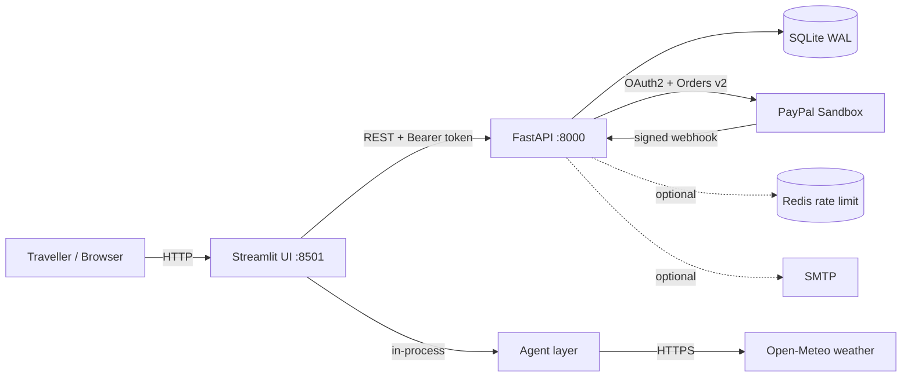
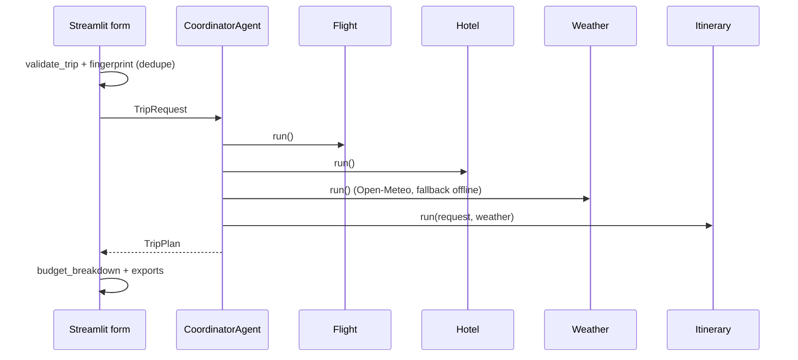
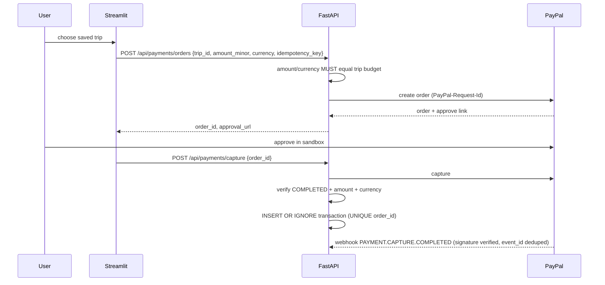
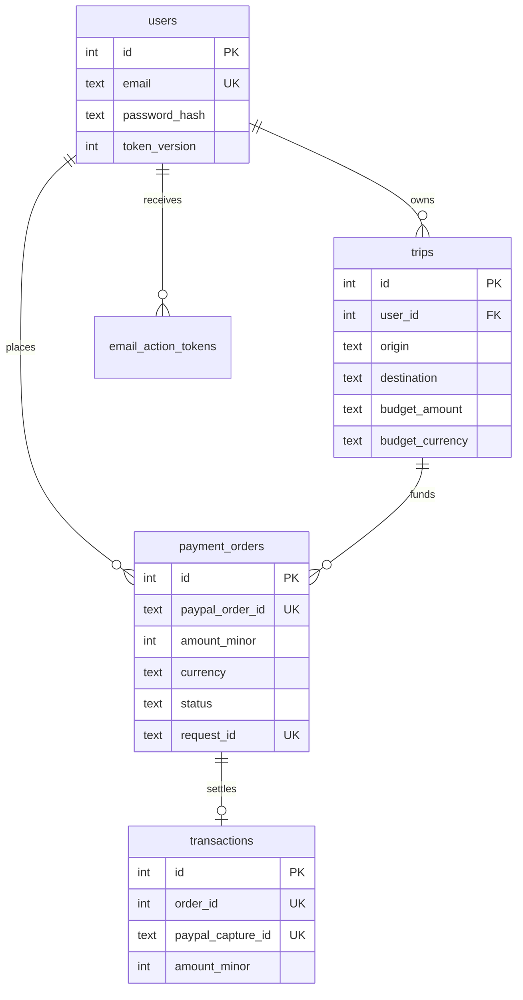

# TripLedger AI — Architecture

## 1. System context

## 2. Layers
| Layer | Path | Responsibility |
|---|---|---|
| Presentation | `app.py`, `ui/theme.py`, `ui/tripledger_portal.py` | Pages, motion layer, API client, escaping |
| Planner (domain) | `agents/`, `utils/`, `tools/` | Coordinator orchestrates flight, hotel, weather and itinerary agents into a `TripPlan` dataclass |
| API | `backend/api/*` | Routers: auth, trips, payments, webhooks |
| Core | `backend/core/*` | Config, DB, token/password security, **money helpers** |
| Services | `backend/services/*` | PayPal client, SMTP, rate limiter |
| Persistence | `data/tripledger.db` | SQLite (WAL, foreign keys ON) |

## 3. Planner flow

Identical inputs reuse the cached plan in `st.session_state` (max 3 entries) to prevent double processing.

## 4. Payment flow (trust boundary is the server)

Guarantees: the browser can never choose the payable amount; replayed capture/webhook calls cannot create a second ledger row (`UNIQUE` constraints + `INSERT OR IGNORE`); zero-decimal currencies use whole units.

## 5. Data model

Also: `revoked_tokens`, `webhook_events (event_id UNIQUE)`, `audit_logs`.

## 6. Security model
| Threat | Control |
|---|---|
| Credential stuffing | PBKDF2 310k, per-IP limit 8/min on auth routes (Redis when configured), generic error text |
| Token theft/replay | 60-min expiry, `jti`, server-side revocation list, `token_version` invalidation after password reset |
| Cross-user access | Every query filtered by `user_id`; foreign trip/order → 404 |
| Payment tampering | Server compares amount + currency to saved trip and again to PayPal's capture |
| Webhook forgery | PayPal `verify-webhook-signature` + event-id dedupe |
| XSS | `html.escape` on all interpolated user/API text in `unsafe_allow_html` blocks |
| CSV injection | Leading `= + - @` neutralised in exports |
| Clickjacking / sniffing | `X-Frame-Options`, `nosniff`, `no-store`, strict CORS |

## 7. Frontend motion architecture
`ui/theme.py` injects one CSS block *after* the original stylesheet and reuses its tokens (`--green`, `--mint`, `--gold`).
Everything is progressive enhancement: scroll-driven reveals fall back to load-time fades; count-up falls back to static numbers; `prefers-reduced-motion` disables all of it. See `DESIGN_SYSTEM.md`.

## 8. Deployment topology
* **Local/demo**: `scripts/start.ps1` (API + Streamlit).
* **Production target**: Streamlit + FastAPI containers behind HTTPS reverse proxy, managed Postgres, Redis, secret manager, PayPal live credentials, restricted CORS. (Postgres adapter is not implemented yet.)

## 9. Key decisions
| Decision | Why | Trade-off |
|---|---|---|
| Streamlit front end | Fastest path to a polished demo in Python | Limited custom components; motion is CSS-only |
| SQLite | Zero-setup for judges | Single-writer; migrate for scale |
| Hand-rolled HS256 token | No extra dependency | Prefer a vetted library (e.g. PyJWT is already installed in some envs) for production |
| Rule-based agents | Runs with no API keys, deterministic tests | Not truly generative yet — roadmap item |
